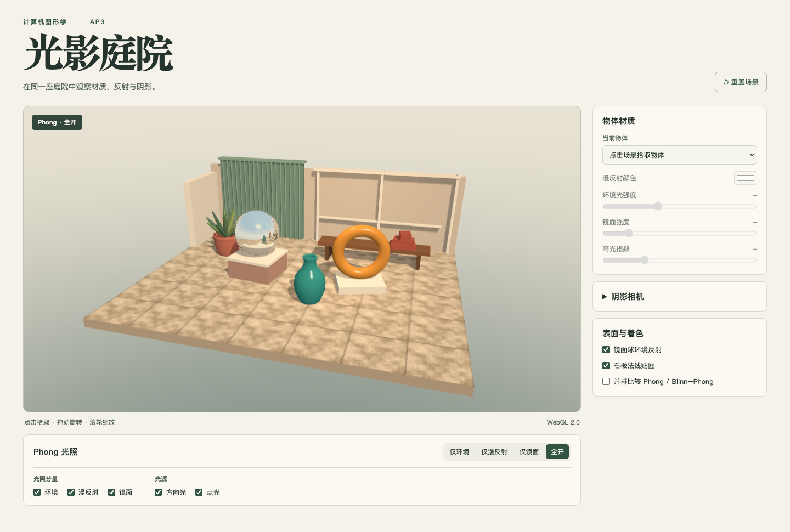
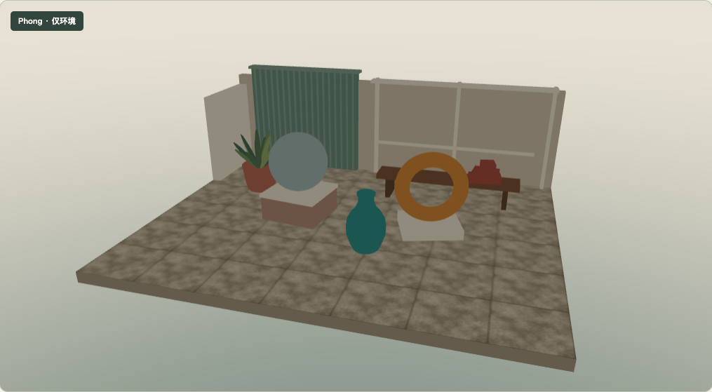
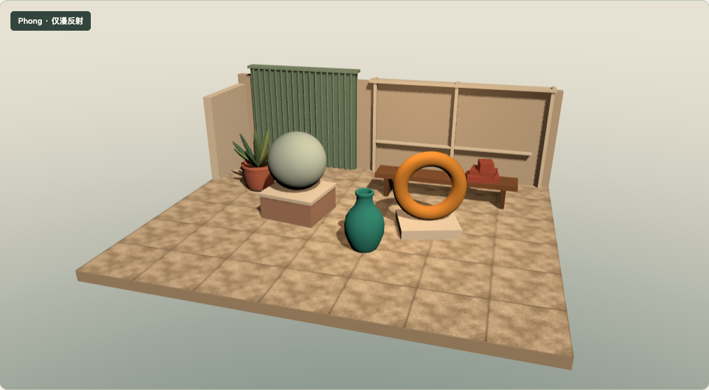
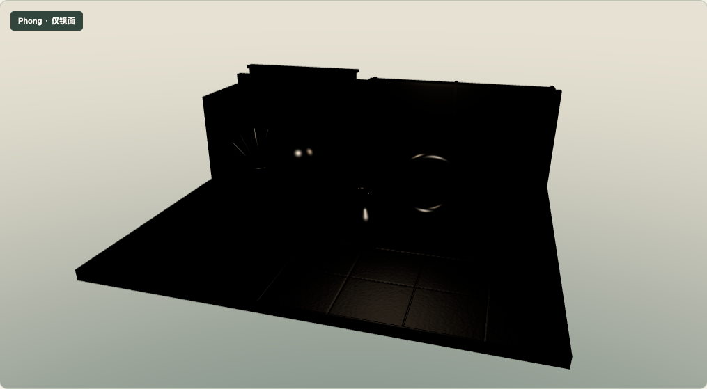
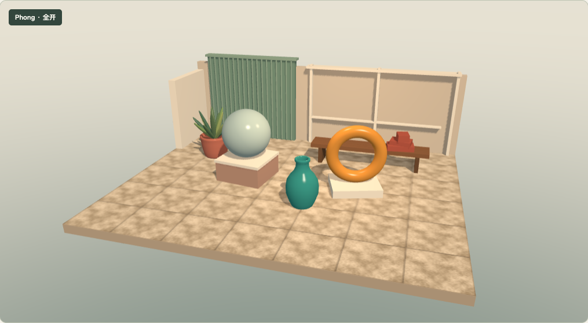
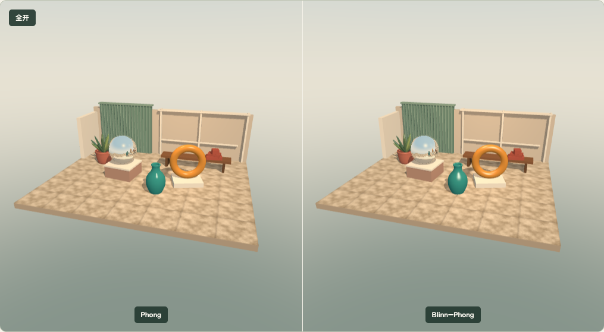

# 光影庭院 · 计算机图形学 AP3

一个可交互的 WebGL 2.0 庭院。场景包含石板地面、胡桃木长凳、镜面球、青釉花瓶、琥珀圆环、龙舌兰花盆和叠置陶砖。方向光照亮庭院并投射阴影，点光源近处较亮，随距离增大而衰减。

- 公网演示：[光影庭院](https://pigbabyye-art.github.io/computer-graphics-ap3/)
- 本地运行：解压后进入包含 `index.html` 的目录，执行 `python3 -m http.server 8313`，再打开 [本地页面](http://127.0.0.1:8313/)。使用支持 WebGL 2.0 的现代浏览器，项目无需构建或联网加载素材。



## 交互与演示

| 操作 | 现象 |
| --- | --- |
| 点击物体或使用“当前物体”下拉框 | 物体以薄荷色边缘和表面着色高亮。右侧载入该物体的漫反射颜色、环境光强度、镜面强度、高光指数 |
| 拖动场景或使用方向键 | 绕观察中心旋转。滚轮或画布聚焦时的 `+` / `-` 缩放，触屏单指拖动可旋转 |
| 点击天空、未编号的墙体或底座，或在画布按 `Esc` | 清除选中 |
| 切换三个分量和两种光源 | 检查各分量的独立作用，四个预设可快速复现对比图 |
| 展开“阴影相机” | 调整方向光投影范围、近远裁剪面、深度偏移和 PCF 采样 |
| 切换“表面与着色”中的选项 | 查看镜面球环境反射、石板法线贴图和 Phong / Blinn–Phong 并排对照 |
| 点击“重置场景” | 恢复初始相机、光照、阴影与材质设置 |

现场可先关掉镜面球环境反射，切换四个预设。然后点选青釉花瓶，改变漫反射颜色或高光指数；再展开阴影相机，将采样切为“单次采样”，把正交半宽拉大，观察物体投在地上的阴影边缘。

## 手写 Phong 光照

顶点着色器以模型矩阵计算世界位置，用模型矩阵的逆转置变换法线。片元着色器归一化插值法线 `N`，在世界空间求观察方向 `V`、从表面指向光源的单位向量 `L` 及 `R = reflect(-L, N)`。漫反射和镜面分量只在 `dot(N, L) > 0` 的受光面计算。

| 分量 | 计算 | 可调参数 |
| --- | --- | --- |
| 环境 | `ambientColor × ka × albedo` | `uAmbient` |
| 漫反射 | `lightColor × albedo × max(dot(N, L), 0)` | `uColor` 是漫反射颜色，有纹理时再乘位图颜色 |
| 镜面 | `lightColor × ks × max(dot(R, V), 0)^gloss` | `uSpecular`、`uGloss` |

`uTerms` 的三个分量分别控制环境、漫反射和镜面项。方向光使用恒定方向和颜色，点光的方向与衰减随片元位置变化。环境反射和选中高亮有单独的绘制控制。点光的漫反射和镜面项均按 `1 / (1 + 0.18 × distance²)` 衰减。

四张截图使用同一个相机、材质和两盏光源，无选中物体。统一关闭镜面球的环境反射，仅切换 Phong 分量。镜面项独开时，多数没有高光的表面呈黑色，仍能看见球、釉面、圆环和地面上的高光。

| 仅环境 | 仅漫反射 |
| --- | --- |
|  |  |
| **仅镜面** | **三分量全开** |
|  |  |

## 石板地面的 UV 展开

从上往下看石板地面。整张平面展开为一个矩形，由两片三角形组成。U 向右对应世界 +X，V 向后对应世界 −Z。

```text
                              +U / +X
                (0,1) ┌────────────────┐ (1,1)  后侧 −Z
                      │  ╲             │
           +V / −Z ↑  │       ╲        │
                      │            ╲   │
                (0,0) └────────────────┘ (1,0)  前侧 +Z

   地面顶点 (position, normal, uv)
         → vertexAttribPointer(location = 2)
         → 顶点着色器输出 vUv → 光栅化插值
         → 片元着色器 texture(uStone, vUv × (7,6))
         → 纹理 RGB × 漫反射颜色 → Phong 各分量
```

`textures/limestone.png` 是自制位图。通过 `gl.texImage2D` 上传到 `SRGB8_ALPHA8` 纹理；上传时设置 `UNPACK_FLIP_Y_WEBGL`，让位图顶行对应较大的 V 值。使用默认 `REPEAT` 及 mipmap，横向重复 7 次，纵向重复 6 次。

## Cubemap 环境反射

初始化时，以镜面球球心为相机位置，用 90° 透视投影沿 ±X、±Y、±Z 渲染六个方向。每次用 `gl.framebufferTexture2D` 将对应立方体面挂到 FBO 的颜色附件，排除镜面球自身。渲染镜面球时用 `reflect(-V, N)` 计算世界空间反射方向，`samplerCube` 按该方向取样，并与球体自身的 Phong 颜色混合。Cubemap 保存初始化时的庭院与天空，后续调参会更新画面中的物体，镜面内仍呈现初始环境。

## 阴影的两遍渲染

1. **从方向光观察。** 沿方向光轴建立正交相机，把遮挡物的深度渲染到 FBO 的 1024 × 1024 深度纹理。深度通过光源视投影矩阵生成。方向光投影范围或裁剪面变化时重画深度图。
2. **从观察相机观察。** 将表面位置变换到同一个光源裁剪空间，经透视除法与重映射得到纹理坐标和接收点深度。若 `receiverDepth − bias > storedDepth`，该采样点被遮挡。阴影系数乘在方向光的漫反射和镜面项上，点光与环境光仍可照亮阴影区。

增大正交半宽会让相同的深度纹理覆盖更宽的区域，每个 texel 对应的世界范围随之增大。切到单次采样可观察锯齿，3 × 3 或 5 × 5 PCF 将邻近比较结果取平均。第一遍使用斜率多边形偏移抑制自阴影条纹，第二遍可调的比较偏移过大时会出现阴影脱离物体或漏光。将光源裁剪范围缩得过窄时，超出投影范围的片元按受光处理。

## 拾取和材质联动

点击时，用当前视投影矩阵绘制独立的拾取 FBO。片元着色器把物体编号编码到颜色的 R 通道，深度缓冲确保读到最前面的表面。用画布边界、绘图缓冲区尺寸和 Y 坐标翻转换算点击像素，再由 `gl.readPixels` 读取一个像素还原编号。每个可选物体有自己的材质对象，花盆、长凳等组合模型共用同一个拾取编号。面板更新选中物体的材质，下一帧上传该物体的 uniforms 和高亮状态。拖动超过 5 CSS 像素开始旋转，松开时不触发拾取。

## 选做扩展

- **E1 法线贴图。** `limestone-normal.png` 的 RGB 编码切线空间法线。片元着色器用 `RGB × 2 − 1` 解码，经地面的 TBN 基变换到世界坐标。开关只改变受光使用的法线，石板的几何外形和颜色位图保持一致。
- **E3 Blinn–Phong。** 并排使用相同相机、材质和光照参数。左侧 Phong 使用 `dot(R, V)`，右侧 Blinn–Phong 使用半程向量 `H = normalize(L + V)` 和 `dot(N, H)`。相同指数下，右侧圆环和釉面花瓶的高光通常更宽。对照视图中仍可点击两侧物体拾取。



## 源码与来源

| 文件 | 作用 |
| --- | --- |
| `scene.js`、`mesh.js` | 庭院组装、材质定义、顶点与索引生成 |
| `renderer.js` | 渲染资源、光源深度、立方体贴图和拾取 FBO |
| `shaders.js` | 手写 GLSL 程序 |
| `app.js`、`index.html`、`style.css` | UI、选中状态、相机输入与响应式布局 |
| `textures/`、`docs/` | 自制纹理位图与浏览器实拍截图 |

使用课程 AP2 中已有的教材配套 [MV.js](https://github.com/esangel/WebGL/blob/master/Common/MV.js) 进行矩阵与向量运算，版权和 MIT 许可见 [Common/LICENSE-MV.md](Common/LICENSE-MV.md)。GLSL、庭院几何和两张纹理为该项目编写。项目在 Codex 辅助下实现和验证。
